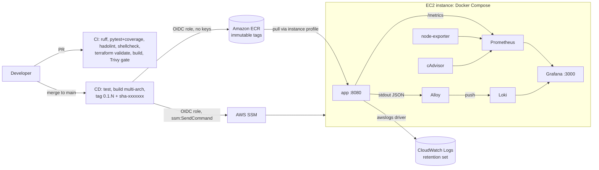
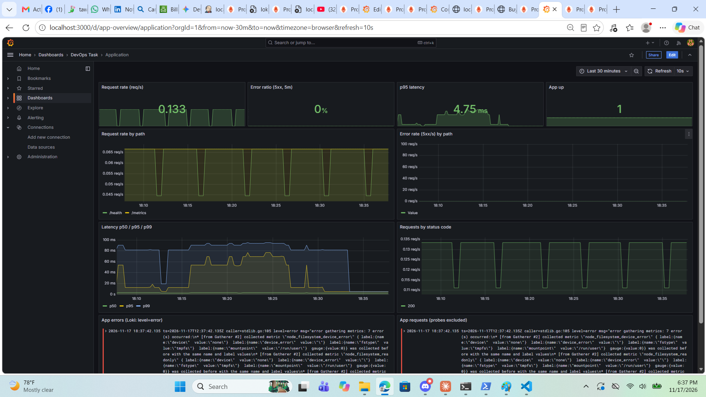
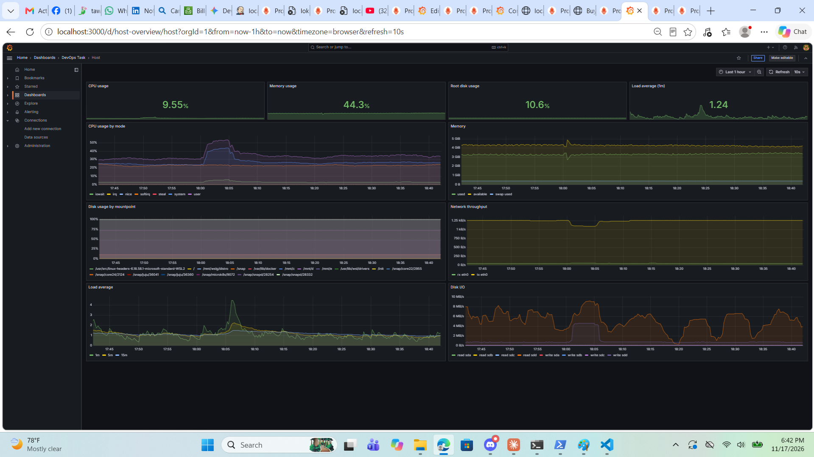

# DevOps Task: FastAPI service on AWS EC2 with full observability

A small FastAPI service taken from source to a deployed, observable state: Docker, GitHub Actions
(with security gates), Terraform on AWS EC2, Kubernetes manifests (kind), Prometheus/Grafana/Loki/Alloy
monitoring, and a Bash health-check script.

> **Evidence checklist (fill before submitting):** items marked `TODO` below need real output or
> screenshots from your own runs. Don't leave a TODO in the final version.

## Contents
1. [Repository layout](#1-repository-layout)
2. [Architecture](#2-architecture)
3. [Run locally](#3-run-locally-docker-compose)
4. [Deploy to AWS EC2 (runbook)](#4-deploy-to-aws-ec2-runbook)
5. [CI/CD and required configuration](#5-cicd-and-required-configuration)
6. [Kubernetes (kind)](#6-kubernetes-kind)
7. [Observability](#7-observability)
8. [system_health.sh](#8-system_healthsh)
9. [Design decisions](#9-design-decisions)
10. [Deployment and rollback strategy](#10-deployment-and-rollback-strategy)
11. [Security considerations](#11-security-considerations)
12. [Cost estimate](#12-monthly-aws-cost-estimate)
13. [What I would improve](#13-what-i-would-improve-with-more-time)
14. [AI usage note](#14-ai-usage-note)

## 1. Repository layout
```
app/                      FastAPI app, tests, Dockerfile, .dockerignore
docker-compose.yml        app (port 8080, healthcheck, restart, limits)
docker-compose.monitoring.yml   Prometheus, Loki, Alloy, Node Exporter, cAdvisor, Grafana
docker-compose.aws.yml    EC2 overlay: ECR image + CloudWatch log driver
observability/            prometheus (config + alert rules), loki, alloy, grafana (provisioning + 3 dashboards)
terraform/                EC2 stack (envs/staging|production) ; terraform/bootstrap = state bucket, ECR, OIDC
.github/workflows/        ci.yml (PRs), cd.yml (main), deploy.yml (reusable SSM deploy)
k8s/                      Kustomize manifests + kind config
scripts/                  system_health.sh, deploy.sh (runs on EC2), k8s-demo.sh, systemd units, cron entry
VERSION                   major.minor; CI appends the run number for a semver tag (0.1.<run>)
```

## 2. Architecture

Kubernetes flow (local kind cluster): `docker build` → `kind load` → `kubectl apply -k k8s/` →
Ingress (nginx) → Service → 2+ pods (HPA 2–5) ; `kubectl set image` for rolling updates, `rollout undo` to revert.

## 3. Run locally (Docker Compose)
Prerequisites: Docker 24+ with the Compose v2 plugin, Python 3.12 (only for running tests).
```bash
cp .env.example .env                       # set GRAFANA_ADMIN_PASSWORD
# app only
docker compose up --build -d && curl localhost:8080/
# app + full observability
docker compose -f docker-compose.yml -f docker-compose.monitoring.yml up --build -d
# Grafana: http://localhost:3000  (user from .env, folder "DevOps Task")
```
Run the tests: `cd app && pip install -r requirements-dev.txt && ruff check . && pytest`

Generate an error spike for the walkthrough: set `ENABLE_FAULT_INJECTION=true` in `.env`,
recreate the app, then `for i in $(seq 50); do curl -s -o /dev/null localhost:8080/debug/error; done`.

**Final image size:27.2 MB (optimized multi-stage Alpine Python build).

## 4. Deploy to AWS EC2 (runbook)
Prerequisites: AWS CLI configured with an admin-capable profile (for the one-time bootstrap),
Terraform >= 1.10, a **public** GitHub repo containing this code (the instance clones it).

**Step 1: bootstrap (once per AWS account): state bucket, ECR repo, GitHub OIDC provider + CI push role**
```bash
cd terraform/bootstrap
terraform init
terraform apply -var github_repo=YOUR_USER/YOUR_REPO
# note the outputs: state_bucket, ecr_repository_url, ecr_repository_arn, ci_push_role_arn
```
**Step 2: staging stack.** Edit `terraform/envs/staging.tfvars` (repo, your IP for `admin_cidrs`, ECR url/arn from step 1).
```bash
cd terraform
terraform init -backend-config=envs/staging.backend.hcl -backend-config="bucket=<state_bucket>"
terraform plan  -var-file=envs/staging.tfvars
terraform apply -var-file=envs/staging.tfvars
```
Repeat with `production` files after `terraform init -reconfigure -backend-config=envs/production.backend.hcl ...`
(separate state key, same code). Outputs: `instance_id`, `public_ip`, `deploy_role_arn`, `grafana_ssm_parameter`.

**Step 3: create the Grafana admin password (never in git or Terraform state)**
```bash
aws ssm put-parameter --region us-west-2 --type SecureString \
  --name /devops-task/staging/grafana_admin_password --value "$(openssl rand -base64 18)"
```
**Step 4: configure GitHub** (see section 5), then push to `main`. CD builds, pushes, and deploys.

**Step 5: verify**
```bash
curl http://<public_ip>:8080/            # {"message":"Hello from DevOps Task!","status":"running","version":"0.1.N"}
curl http://<public_ip>:8080/health
# Grafana: http://<public_ip>:3000   (reachable only from admin_cidrs)
aws ssm start-session --target <instance_id>   # shell access, no SSH, no open port 22
sudo docker ps; systemctl list-timers system-health.timer; tail /var/log/system_health/health_log.txt
```
**Step 6: tear down when finished (cost):** `terraform destroy -var-file=envs/staging.tfvars`, then the bootstrap stack
(empty the ECR repo and state bucket first). Keep workflow logs/screenshots as evidence.

Evidence: `TODO` (terraform plan output, apply output, successful CD run link/screenshots).

## 5. CI/CD and required configuration
| Workflow | Trigger | What it does |
|---|---|---|
| `ci.yml` | pull_request | ruff, pytest + coverage report, hadolint, shellcheck, terraform fmt/validate, image build, **Trivy gate: fails on CRITICAL** |
| `cd.yml` | push to main | test → multi-arch (amd64+arm64) build with GHA layer cache → push to ECR → deploy staging → deploy production (needs approval) |
| `deploy.yml` | called by cd.yml | assumes env-scoped role via OIDC, runs `scripts/deploy.sh` on the instance through SSM, fails the job if the deploy or smoke test fails |

**Secrets: none.** AWS access uses GitHub OIDC; the only secret (Grafana password) lives in SSM Parameter Store.

**Repository variables** (Settings → Secrets and variables → Actions → Variables):
`AWS_REGION`, `AWS_CI_ROLE_ARN` (bootstrap output `ci_push_role_arn`), `ECR_REPOSITORY` (bootstrap output `ecr_repository_url`).

**Environment variables** (create environments `staging` and `production`; add *required reviewers* to `production`):
`AWS_DEPLOY_ROLE_ARN` (output `deploy_role_arn`) and `EC2_INSTANCE_ID` (output `instance_id`), set per environment.

**Tagging:** every image gets `0.1.<run_number>` (semantic version from `VERSION` + run) and `sha-<7 chars>`.
ECR tags are immutable and `latest` is never used, so a tag always identifies exactly one build.

**Branch protection (recommended):** require the CI checks and a PR review on `main`.

## 6. Kubernetes (kind)
Prerequisites: Docker. `scripts/k8s-demo.sh` installs `kind`/`kubectl` into `./bin` if missing, creates the cluster,
installs ingress-nginx and metrics-server, builds and loads images `1.0.0`/`2.0.0`, deploys, runs a rolling update **while
sending traffic**, then `rollout undo`, and prints the status-code tally.
```bash
./scripts/k8s-demo.sh
```
Manifests (`k8s/`): Deployment (2 replicas, `maxUnavailable: 0`/`maxSurge: 1`, readiness + liveness on `/health`,
requests/limits, non-root, read-only root FS, all capabilities dropped, seccomp), Service, Ingress, ConfigMap,
HPA (CPU 70%, 2–5), PodDisruptionBudget. Port-forward alternative: `kubectl -n devops-task port-forward svc/devops-task 8080:80`.

**Secrets approach:** no secret is committed. `secret.example.yaml` is a template excluded from the kustomization; the real
Secret is created with `kubectl create secret generic ...` and consumed through an optional `secretRef`.

Manual rollout/rollback commands and captured output: `TODO` (paste output of `kubectl rollout status`, `rollout history`, `rollout undo`, and the final `uniq -c` tally showing only `200`).

**On EKS in production:** AWS Load Balancer Controller for ALB Ingress (+ ACM TLS) instead of ingress-nginx on kind;
External Secrets Operator or Secrets Store CSI Driver reading AWS Secrets Manager; IRSA (or EKS Pod Identity) for
per-service-account IAM instead of node-wide roles; Karpenter/Cluster Autoscaler for node scaling alongside the HPA;
images from ECR with immutable tags and admission policy (signature/scan); managed node groups across 3 AZs with topology spread
constraints; kube-prometheus-stack + Loki for observability; NetworkPolicies; and GitOps (Argo CD/Flux) for deploys.

## 7. Observability
Started with `docker-compose.monitoring.yml` (on EC2 the CD pipeline starts it for you). All images are version-pinned.

| Component | Role | Exposure |
|---|---|---|
| Prometheus | scrapes app `/metrics`, node-exporter, cAdvisor; **15 d / 2 GB retention** | internal network only |
| Loki | log storage; **7 d retention** (compactor retention enabled) | internal only |
| Alloy | discovers all containers via Docker, parses JSON, ships to Loki | internal only |
| node-exporter | host CPU/mem/disk/network | host network, bound to docker0 IP, 9100 not in the security group |
| cAdvisor | per-container metrics | internal only |
| Grafana | dashboards, explore | **only published port (3000)**; SG limits it to `admin_cidrs` |

**Provisioned as code:** datasources (`observability/grafana/provisioning/datasources`) and dashboards (JSON in
`observability/grafana/dashboards`): 
- **Application** (rate, errors, p50/p95/p99, status codes, Loki error logs and request logs)
- **Host** (CPU, memory, disk, network, load, I/O)
- **Containers** (running count, CPU, memory working set, limit %, network I/O, live container logs).

### Observability Dashboards Preview

**1. Application Dashboard:**


**2. Containers Dashboard:**


**3. Host Dashboard:**


**Log labels (cardinality):** indexed labels are only `container`, `service`, `level` (single-digit values each).
`path`, `method`, `status` are **structured metadata**: filterable (`| path="/debug/error"`) without becoming index
labels, because a label per URL/status would multiply streams and bloat the index.

**Privileges granted and why**
- *cAdvisor:* `privileged: true`, `/dev/kmsg`, and read-only mounts of `/`, `/var/run`, `/sys`, `/var/lib/docker`, `/dev/disk`: required to read cgroup and container metadata per upstream docs.
- *node-exporter:* `network_mode: host` + `pid: host` + `/:/host:ro`: otherwise it would report the container's namespace, not the host's. Bound to `172.17.0.1:9100` so it is not reachable from outside.
- *Alloy:* runs as root with the Docker socket mounted read-only to discover containers and read logs. The socket is effectively root on the host; a `docker-socket-proxy` would narrow it (listed under improvements).
- Grafana credentials come from `.env`/SSM (`GRAFANA_ADMIN_PASSWORD` is mandatory: compose refuses to start without it).

**Alert rules** (`observability/prometheus/rules/alerts.yml`; visible read-only in Grafana → Alerting)
| Alert | Condition | `for` | Why |
|---|---|---|---|
| AppDown | `up{job="app"}==0` | 1m | 4 missed scrapes; tolerates a restart, still fast |
| HighErrorRate | 5xx ratio > 5% and > 0.1 req/s | 5m | sustained user impact; traffic floor prevents one failure on idle traffic from paging |
| HighLatencyP95 | p95 > 500 ms | 10m | a trivial endpoint should be far faster; long window avoids bursts |
| HostDiskUsageHigh | any real filesystem > 80% | 10m | disk fills slowly; leaves time to act; filters transient image pulls |
| HostMemoryLow | memory used > 90% | 10m | MemAvailable-based, so cache doesn't count |
| ContainerMemoryNearLimit | working set > 90% of limit | 5m | working set is what the OOM-killer uses; 5m ignores allocation bursts |

Prometheus evaluates rules; with no Alertmanager they are not routed anywhere yet (see improvements).

**Walkthrough: "An error spike appears on the Application dashboard. How do you find the cause?"**
1. *Scope it (metrics):* on **Application**, the Error ratio stat and "Error rate by path" show *which endpoint* is failing and since when; "Requests by status code" shows whether it is 5xx only. Note the spike's start time.
2. *Read the evidence (logs, same view):* the "App errors" Loki panel below shares the time range, so it shows the `level=error` lines from the spike. Expand a line: `path`, `method`, `status`, `version` and, for exceptions, `exc` give the failing request and stack trace.
3. *Correlate with change:* the `version` field in the logs tells you whether the errors began with a new release (compare to the CD run time). If yes, roll back (section 10).
4. *Rule out resources:* open **Containers**: is the app near its memory limit or restarting (OOM)? Open **Host**: CPU, memory or disk saturation, or a noisy neighbour container?
5. *Confirm the fix:* the error ratio returns to 0 and `AppDown`/`HighErrorRate` stay quiet. Use `docker logs`/CloudWatch only as a fallback if Loki is unavailable.
Screenshot of this flow: `TODO`.

## 8. system_health.sh
```bash
./scripts/system_health.sh                       # text, appends to ./health_log.txt
./scripts/system_health.sh --json --disk 80 --cpu 90 --mem 85 --log-file /tmp/h.txt
./scripts/system_health.sh --help ; echo $?      # exit: 0 healthy, 1 warning, 2 critical, 64 usage
shellcheck scripts/*.sh                          # clean
```
Collects CPU (1 s sample of `/proc/stat`), memory, every real mounted filesystem, load average, top 5 processes by memory.
Warnings print as `[WARNING] ...`; critical thresholds (`--*-crit`, defaults 98/95/95) give exit 2. Rotation at 1 MiB keeping 5 files; `flock` prevents overlapping runs.
`HEALTH_WEBHOOK_URL` (env) optionally posts to Slack/Discord on warning/critical.
**Scheduling:** on EC2 the bootstrap installs the script and a **systemd timer every 5 minutes**
(`scripts/systemd/`, log at `/var/log/system_health/health_log.txt`; exit 2 marks the unit failed so it is alertable).
Cron alternative: `scripts/system-health.cron`.

## 9. Design decisions
- **Alpine vs distroless.** Distroless Python is tied to the distro's Python version and has no shell, which makes the HEALTHCHECK and debugging awkward. Alpine + a venv copied from a build stage gives a small image, non-root user, no pip/build tools in the final layer. Trade-off: musl instead of glibc (fine for pure-Python wheels) and a larger package set than distroless. Base pinned by tag; adding the `@sha256` digest is the next hardening step.
- **EC2 vs ECS vs EKS.** The brief asks for EC2, and one small host is the cheapest thing that runs both the app and a self-hosted monitoring stack. ECS/Fargate would remove host patching and the need for cAdvisor/node-exporter but costs more per vCPU and complicates the Compose-based observability; EKS adds ~$73/month of control plane plus node cost, justified only with many services. Single-instance downside: no HA; the instance is a single point of failure.
- **SSM instead of SSH.** No inbound port 22, no key pairs, access is IAM-authenticated and logged, and CI deploys with `ssm:SendCommand` scoped to one instance.
- **Deploy by git checkout + compose on the host.** The instance holds only config; images come from ECR. Simple and auditable, but the repo must be public (or the instance given a deploy credential).
- **Tagging.** Immutable ECR tags: `0.1.<run>` (human-readable semver) and `sha-<commit>` (traceability). Deploys reference the semver tag; the previous tag is recorded on the host for rollback.
- **Secrets.** No static AWS keys anywhere (OIDC + instance profile). Runtime secret in SSM Parameter Store SecureString, fetched at deploy time into a `0600` `.env`; Terraform never sees its value.
- **Logs.** The app emits JSON to stdout; Docker's `awslogs` driver sends it to CloudWatch (retention in Terraform) while Alloy ships it to Loki for Grafana (dual logging keeps `docker logs` working). Labels are low-cardinality; see section 7.
- **Metrics labels** use the route template, never the raw URL, so scanners can't create unbounded series.
- **Terraform state** in S3 with versioning, encryption and native lockfile (`use_lockfile`, Terraform >= 1.10), avoiding a DynamoDB table.
- **Ubuntu 24.04 LTS** (Canonical AMI, found through a public SSM parameter so nothing is hardcoded per region). Chosen for familiarity and long support; the SSM agent ships preinstalled. The AWS CLI v2 and the pinned Compose plugin are installed by the bootstrap.
- **Instance size.** `t3.micro` (free tier, 1 GB) cannot hold the monitoring stack; `t3.small` is the floor for staging, `t3.medium` for production.

## 10. Deployment and rollback strategy
1. PR: all checks must pass (tests, lint, Trivy CRITICAL gate, Terraform validate).
2. Merge to `main`: image built once (amd64+arm64), pushed with immutable tags.
3. **Staging** deploys automatically; **production** waits for a reviewer approval on the GitHub environment, and uses the **same image** (build once, promote).
4. On the instance, `deploy.sh` records the current tag, pulls the new image, `docker compose up -d`, and polls `/health` for up to 60 s.
5. **Automatic rollback:** if the pull, start or smoke test fails, it redeploys the previous tag, re-tests, and exits non-zero so the pipeline is red.
6. **Manual rollback:** re-run CD for an earlier commit, or via SSM: `cd /opt/app && sudo ./scripts/deploy.sh <previous-tag>`. Kubernetes: `kubectl rollout undo deployment/devops-task`.
7. Concurrency group `deploy` serialises deploys. Caveat: compose recreates the single container, so there is a few seconds of downtime on EC2; zero-downtime requires 2+ instances behind a load balancer (or the Kubernetes path).

To test the rollback on staging: `sudo /opt/app/scripts/deploy.sh does-not-exist` (pull fails → previous tag restored), or push a commit that makes `/health` return 500 and watch the pipeline go red while the old version keeps serving. Evidence: `TODO`.

## 11. Security considerations
- **Secrets:** none in git. OIDC for CI, instance profile for the host, SSM SecureString for Grafana. `.env` is git-ignored and `0600` on the host. Kubernetes secrets created out-of-band.
- **Image scanning:** Trivy in PRs (fails on CRITICAL; HIGH reported), ECR scan-on-push as a second check. `ignore-unfixed` is on, so unpatchable CVEs don't block; review them periodically.
- **IAM least privilege:** instance role can only pull from one ECR repo, write to one log group, read one SSM parameter, plus SSM core. CI push role: ECR push to one repo, trust limited to `main`. Deploy roles: `SendCommand` on one instance + one document, trust limited to the matching GitHub environment.
- **Network:** SG opens 8080 (app) and 3000 (Grafana, admin IPs only; Terraform rejects `0.0.0.0/0`). No SSH. Prometheus/Loki/Alloy/cAdvisor have no published ports; node-exporter is bound to docker0 and not in the SG. IMDSv2 required with hop limit 1 so containers can't fetch instance credentials. EBS encrypted.
- **Containers:** non-root UID 10001, read-only root FS, capabilities dropped, `no-new-privileges`, resource limits. Known exceptions: cAdvisor (privileged) and Alloy (root + Docker socket), documented above.
- **Gaps (honest):** HTTP only (no TLS) on 8080/3000; no WAF; Docker socket exposure; no image signing yet.

## 12. Monthly AWS cost estimate
Approximate, `us-west-2` (Oregon), on-demand, 24x7; **verify with the AWS Pricing Calculator**.
| Item | Staging (t3.small) | Production (t3.medium) |
|---|---|---|
| EC2 | ~$15 | ~$30 |
| EBS gp3 30 GB | ~$2.4 | ~$2.4 |
| Public IPv4 (Elastic IP) | ~$3.7 | ~$3.7 |
| CloudWatch Logs (ingest + storage, low volume) | ~$1 | ~$2 |
| ECR + S3 state + SSM | <$1 | <$1 |
| Data transfer out | ~$1 | ~$2–5 |
| **Total** | **~$23** | **~$40** |
Staying on one `t3.medium` is the cheapest viable setup; an HA production variant (2 instances + ALB ≈ +$20 for the ALB and double compute) would be roughly $85–95.
Destroying staging after testing reduces it to cents.

## 13. What I would improve with more time
- Alertmanager routing to Slack/Discord; a runbook link on each alert.
- TLS (ALB + ACM) and a real domain; WAF; restrict app ingress.
- Two instances behind an ALB (or ECS/EKS) for zero-downtime deploys and HA; blue/green.
- Cosign image signing + SBOM in CI; pin base image and actions by digest/SHA; Dependabot/Renovate.
- Docker socket proxy for Alloy; CloudWatch agent for host metrics/alarms; backups for Grafana/Prometheus volumes.
- Helm chart with staging/production values; kube-prometheus-stack on the cluster; OpenTelemetry tracing with Tempo.
- Integration/e2e test stage and a post-deploy synthetic check from outside the instance.
- Ansible hardening playbook (unattended upgrades, auditd).

## 14. AI usage note
`TODO: edit to match what actually happened.` Example: *"I used Claude (Anthropic) to generate first drafts of the app, Dockerfile,
Terraform, workflows, monitoring configs and this README. I reviewed every file, ran the tests, shellcheck and the health script,
deployed to AWS myself, and adjusted <list what you changed>. I can explain each part of the submission."*
