# DevOps Task: FastAPI service on AWS EC2 with full observability

A small FastAPI service taken from source to a deployed, observable state: Docker, GitHub Actions
(with security gates), Terraform on AWS EC2, Kubernetes manifests (kind), a Prometheus / Grafana / Loki /
Alloy / Node Exporter / cAdvisor monitoring stack, and a Bash health-check script.

## Contents
1. [Repository layout](#1-repository-layout)
2. [Architecture](#2-architecture)
3. [Run locally](#3-run-locally-docker-compose)
4. [Deploy to AWS EC2 (runbook)](#4-deploy-to-aws-ec2-runbook)
5. [CI/CD and required configuration](#5-cicd-and-required-configuration)
6. [Kubernetes (kind)](#6-kubernetes-kind)
7. [Observability](#7-observability)
8. [system_health.sh](#8-system_healthsh)
9. [Design decisions](#9-design-decisions)
10. [Deployment and rollback strategy](#10-deployment-and-rollback-strategy)
11. [Security considerations](#11-security-considerations)
12. [Monthly AWS cost estimate](#12-monthly-aws-cost-estimate)
13. [Problems I hit and what I learned](#13-problems-i-hit-and-what-i-learned)
14. [What I would improve with more time](#14-what-i-would-improve-with-more-time)
15. [AI usage note](#15-ai-usage-note)

## 1. Repository layout

```text
app/                            FastAPI app, tests, Dockerfile, .dockerignore
docker-compose.yml              app (port 8080, healthcheck, restart policy, resource limits)
docker-compose.monitoring.yml   Prometheus, Loki, Alloy, Node Exporter, cAdvisor, Grafana
docker-compose.aws.yml          EC2 overlay: ECR image + CloudWatch log driver
observability/                  prometheus (config + alert rules), loki, alloy, grafana (provisioning + 3 dashboards)
terraform/                      EC2 stack (envs/staging|production); terraform/bootstrap = state bucket, ECR, OIDC
.github/workflows/              ci.yml (pull requests), cd.yml (main), deploy.yml (reusable SSM deploy)
k8s/                            Kustomize manifests + kind config
scripts/                        system_health.sh, deploy.sh (runs on EC2), k8s-demo.sh, systemd units, cron entry
VERSION                         major.minor; CI appends the run number for a semver tag (0.1.<run>)
```

## 2. Architecture

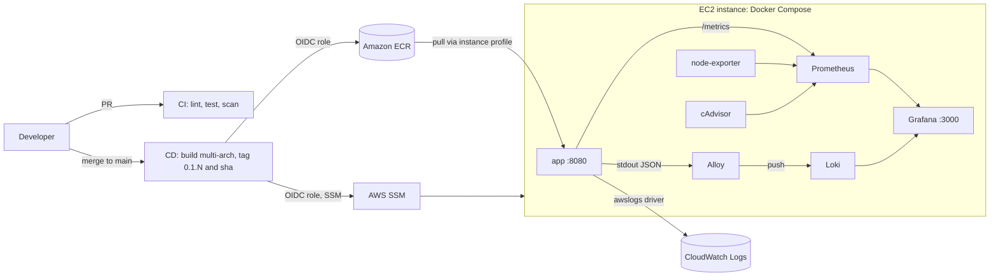

Kubernetes flow (local kind cluster): build image, `kind load`, `kubectl apply -k k8s/`, Ingress, Service, pods.

## 3. Run locally (Docker Compose)

Prerequisites: Docker 24+ with the Compose v2 plugin, Python 3.12 (only for running tests).

```bash
cp .env.example .env                       # set GRAFANA_ADMIN_PASSWORD
# app only
docker compose up --build -d && curl localhost:8080/
# app + full observability
docker compose -f docker-compose.yml -f docker-compose.monitoring.yml up --build -d
# Grafana: http://localhost:3000  (user/password from .env, folder "DevOps Task")
```

The Compose project name is fixed (`name: devops-task`) because Alloy only collects logs from containers of this project.

Run the tests: `cd app && pip install -r requirements-dev.txt && ruff check . && pytest`

Generate an error spike for the walkthrough: set `ENABLE_FAULT_INJECTION=true` in `.env`, recreate the app, then
`for i in $(seq 50); do curl -s -o /dev/null localhost:8080/debug/error; done`. Never enable this in production.

**Final image size:** 115 MB (`docker images devops-task`).

## 4. Deploy to AWS EC2 (runbook)

Prerequisites: AWS CLI configured with an admin-capable profile (for the one-time bootstrap), Terraform >= 1.10,
and a **public** GitHub repo containing this code (the instance clones it).

**Step 1: bootstrap (once per AWS account): state bucket, ECR repo, GitHub OIDC provider and CI push role**
```bash
cd terraform/bootstrap
terraform init
terraform apply -var github_repo=YOUR_USER/YOUR_REPO
# note the outputs: state_bucket, ecr_repository_url, ecr_repository_arn, ci_push_role_arn
```

**Step 2: staging stack.** Edit `terraform/envs/staging.tfvars` (repo, your IP for `admin_cidrs`, ECR url/arn from step 1).
```bash
cd terraform
terraform init -backend-config=envs/staging.backend.hcl -backend-config="bucket=<state_bucket>"
terraform plan  -var-file=envs/staging.tfvars
terraform apply -var-file=envs/staging.tfvars
```
The same code provisions production with `envs/production.tfvars` and `envs/production.backend.hcl` (separate state key).
Outputs: `instance_id`, `public_ip`, `deploy_role_arn`, `grafana_ssm_parameter`.

**Step 3: create the Grafana admin password (never in git or in Terraform state)**
```bash
aws ssm put-parameter --region us-west-2 --type SecureString \
  --name /devops-task/staging/grafana_admin_password --value "$(openssl rand -hex 12)"
# read it back when you need to log in:
aws ssm get-parameter --region us-west-2 --name /devops-task/staging/grafana_admin_password \
  --with-decryption --query Parameter.Value --output text
```

**Step 4: configure GitHub** (section 5), wait until the instance bootstrap has finished
(`sudo tail -3 /var/log/bootstrap.log` in Session Manager says "bootstrap complete"), then push to `main`.
CD builds, pushes and deploys.

**Step 5: verify**
```bash
curl http://<public_ip>:8080/            # {"message":"Hello from DevOps Task!","status":"running","version":"0.1.N"}
curl http://<public_ip>:8080/health
# Grafana: http://<public_ip>:3000   (reachable only from admin_cidrs)
aws ssm start-session --target <instance_id>   # shell access, no SSH, no open port 22
sudo docker ps; systemctl list-timers system-health.timer; tail /var/log/system_health/health_log.txt
```

**Step 6: tear down when finished (cost):** `terraform destroy -var-file=envs/staging.tfvars`, then the bootstrap stack
(empty the ECR repo and the state bucket first).

### Evidence and execution proof

Production was **not applied** to save cost; its configuration is proven with a plan against its own state key:
`terraform plan -var-file=envs/production.tfvars`.

**Terraform plan and apply (staging):**

**Terraform plan and apply (staging):**
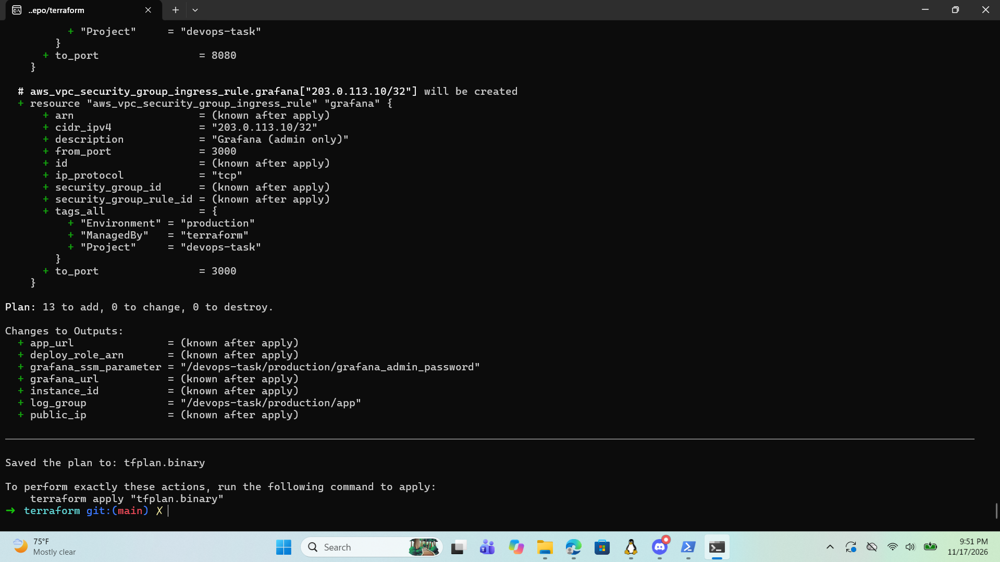
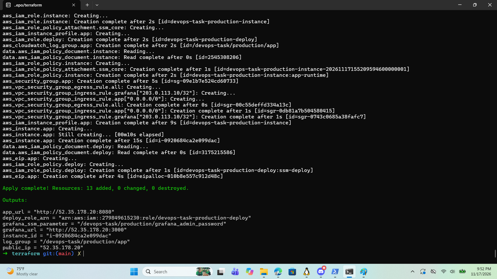

**Staging deploy and smoke test (CD run):**
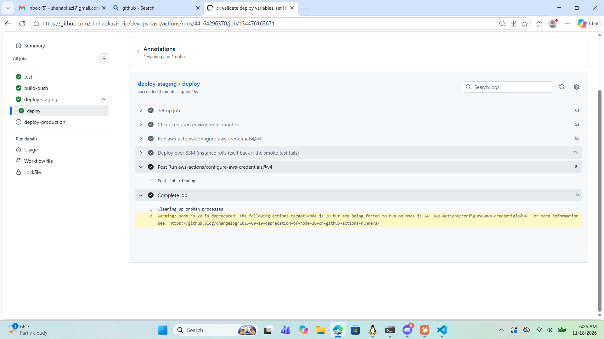
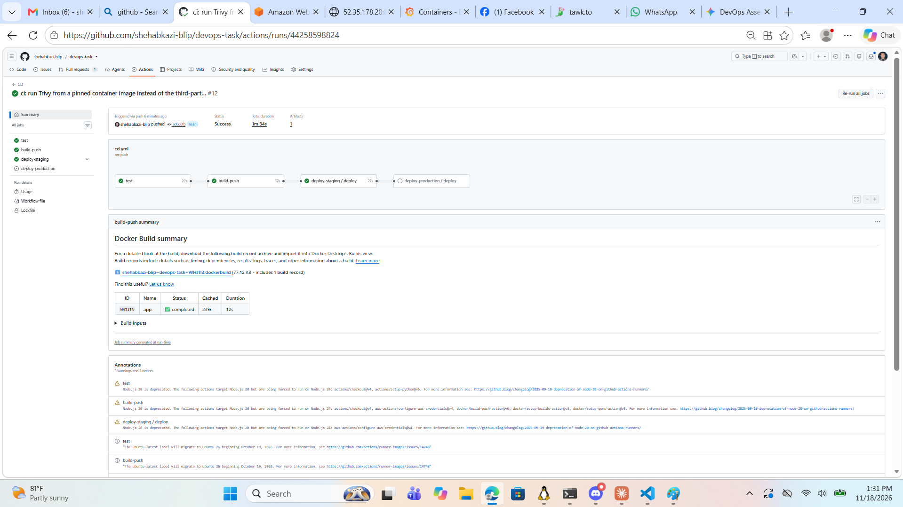
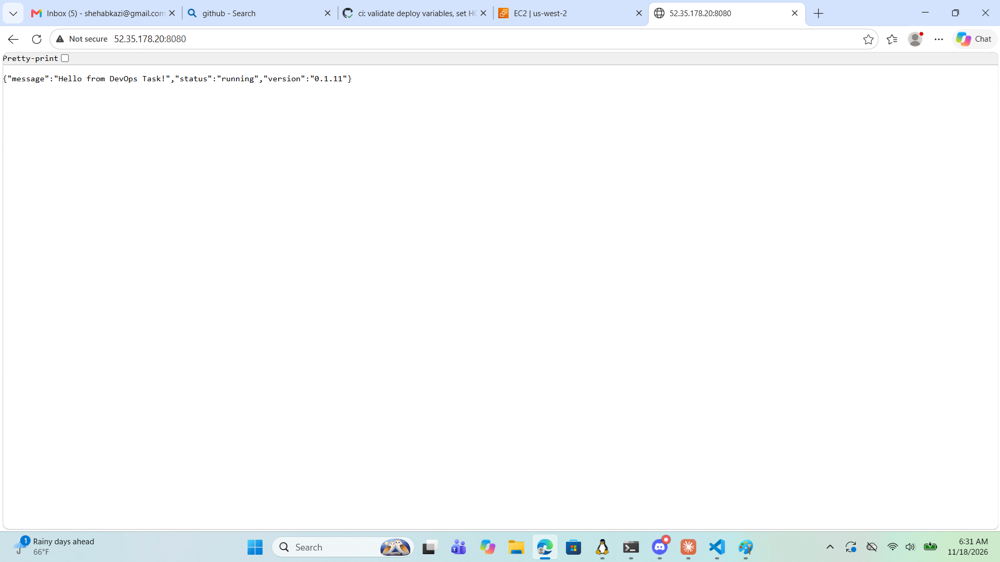


## 5. CI/CD and required configuration

| Workflow | Trigger | What it does |
|---|---|---|
| `ci.yml` | pull_request | ruff, pytest + coverage report, hadolint, shellcheck, terraform fmt/validate, image build, **Trivy gate: fails on CRITICAL** |
| `cd.yml` | push to main | test, multi-arch (amd64 + arm64) build with GHA layer cache, push to ECR, deploy staging, deploy production (disabled by default, see below) |
| `deploy.yml` | called by cd.yml | assumes an environment-scoped role via OIDC, runs `scripts/deploy.sh` on the instance through SSM, fails the job if the deploy or the smoke test fails |

**CI proof (pull request checks):**

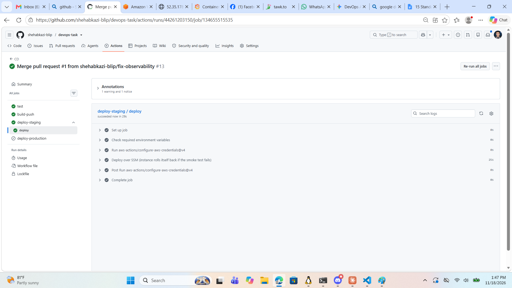

**Secrets: none.** AWS access uses GitHub OIDC; the only secret (the Grafana password) lives in SSM Parameter Store.

**Required GitHub configuration** (Settings, Secrets and variables, Actions, Variables):
- Environment `staging`, with two environment variables: `AWS_DEPLOY_ROLE_ARN` (Terraform output `deploy_role_arn`) and
  `EC2_INSTANCE_ID` (output `instance_id`).
- Optional repo variable `AWS_REGION` (defaults to `us-west-2` in the workflow).
- The CI push role ARN is written in `cd.yml`. An IAM role ARN is an identifier, not a credential.
- The registry address comes from the ECR login step, so no registry variable is needed.
- `deploy-production` only runs when the repo variable `ENABLE_PRODUCTION=true`; it also needs an environment named
  `production` with required reviewers.

**Tagging:** every image gets `0.1.<run_number>` (semantic version from `VERSION` plus the run number) and `sha-<7 chars>`.
ECR tags are immutable and `latest` is never used, so a tag always identifies exactly one build.

**Trivy** runs from a pinned container image (`aquasec/trivy`) instead of a marketplace action: the action's version tags
were removed and re-pointed during a supply-chain incident, which is a bad property for a security gate.

**Branch protection (recommended):** require the CI checks and a PR review on `main`.

## 6. Kubernetes (kind)

Prerequisites: Docker. `scripts/k8s-demo.sh` installs `kind` and `kubectl` into `./bin` if missing, creates the cluster,
installs ingress-nginx and metrics-server, builds and loads images `1.0.0` and `2.0.0`, deploys, runs a rolling update
**while sending traffic**, then `kubectl rollout undo`, and prints the status-code tally.

```bash
./scripts/k8s-demo.sh
```

Manifests (`k8s/`): Deployment (2 replicas, `maxUnavailable: 0` / `maxSurge: 1`, readiness and liveness probes on `/health`,
requests and limits, non-root, read-only root filesystem, all capabilities dropped, seccomp), Service, Ingress, ConfigMap,
HPA (CPU 70%, 2 to 5 replicas), PodDisruptionBudget. Port-forward alternative:
`kubectl -n devops-task port-forward svc/devops-task 8080:80`.

**Secrets approach:** no secret is committed. `secret.example.yaml` is a template excluded from the kustomization; the real
Secret is created with `kubectl create secret generic ...` and consumed through an optional `secretRef`.

**Rollout and rollback proof** (commands and output, only HTTP 200 during the update):

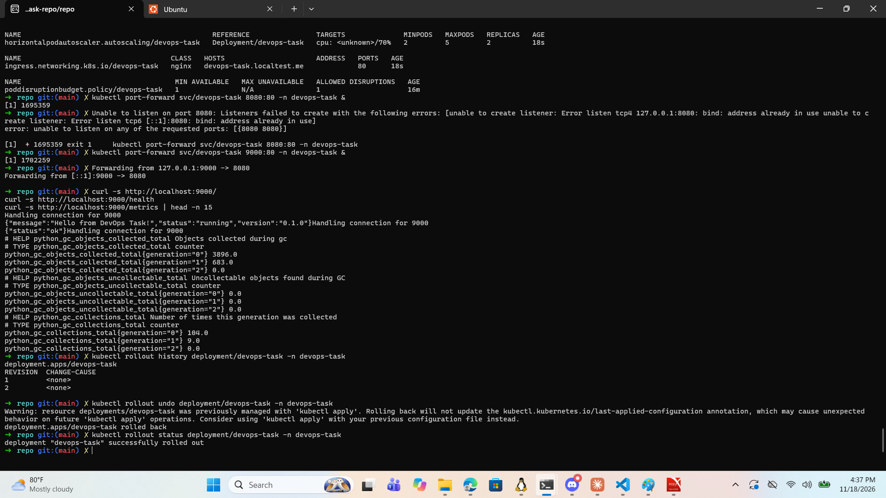

**On EKS in production:** AWS Load Balancer Controller for ALB Ingress (plus ACM TLS) instead of ingress-nginx on kind;
External Secrets Operator or the Secrets Store CSI Driver reading AWS Secrets Manager; IRSA (or EKS Pod Identity) for
per-service-account IAM instead of node-wide roles; Karpenter or Cluster Autoscaler for node scaling alongside the HPA;
images from ECR with immutable tags and an admission policy (signature and scan); managed node groups across 3 AZs with
topology spread constraints; kube-prometheus-stack plus Loki for observability; NetworkPolicies; and GitOps
(Argo CD or Flux) for deploys.

## 7. Observability

Started with `docker-compose.monitoring.yml` (on EC2 the CD pipeline starts it). All images are version-pinned.

| Component | Role | Exposure |
|---|---|---|
| Prometheus | scrapes app `/metrics`, node-exporter, cAdvisor; **15 d / 2 GB retention** | internal network only |
| Loki | log storage; **7 d retention** (compactor retention enabled) | internal only |
| Alloy | discovers this project's containers through Docker, parses JSON, ships to Loki | internal only |
| node-exporter | host CPU, memory, disk | internal only |
| cAdvisor | per-container metrics | internal only |
| Grafana | dashboards, Explore | **only published port (3000)**; the security group limits it to `admin_cidrs` |

**Provisioned as code:** data sources (`observability/grafana/provisioning/datasources`) and dashboards (JSON in
`observability/grafana/dashboards`):
- **Application:** request rate, error rate, p50/p95/p99 latency, status codes, plus Loki error logs and request logs.
- **Host:** CPU, memory, disk, network, load, I/O.
- **Containers:** running count, CPU, memory working set, memory vs limit (%), network I/O, live container logs.

### Observability Dashboards Preview

All three dashboards are provisioned from files, so they look the same locally and on EC2.

**A. Local run (docker compose, laptop)**
* **Application Dashboard:**
  
* **Containers Dashboard:**
  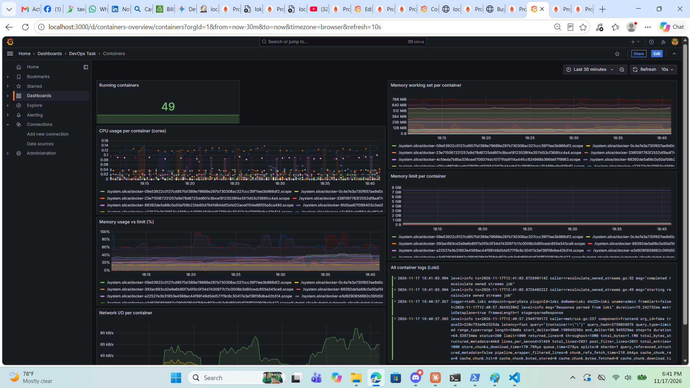
* **Host Dashboard:**
  

**B. AWS EC2 (staging, deployed by the CD pipeline)**
* **Application Dashboard:**
  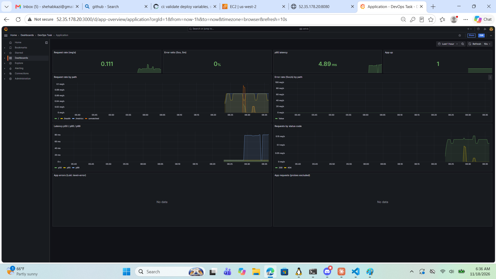
* **Containers Dashboard:**
  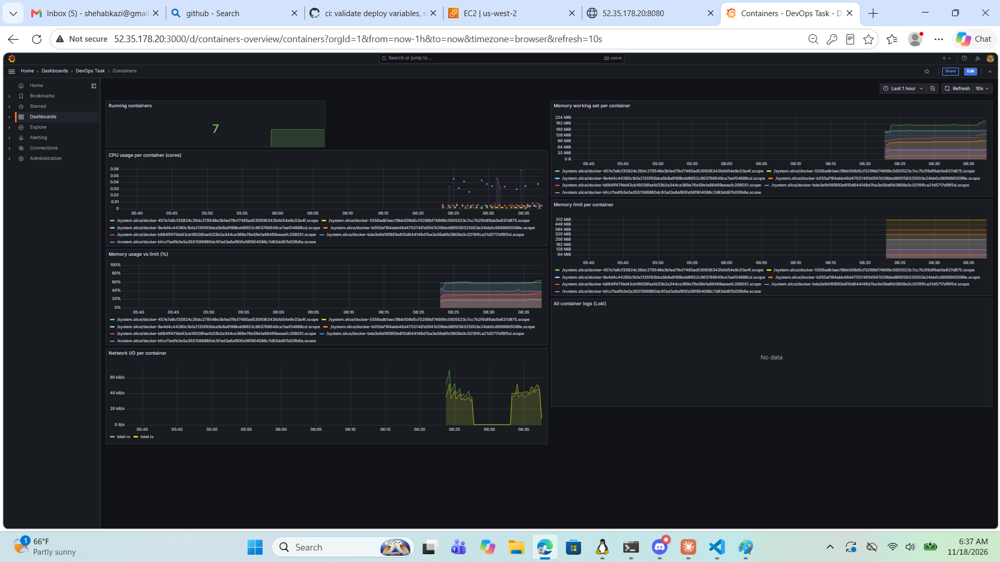
* **Host Dashboard:**
  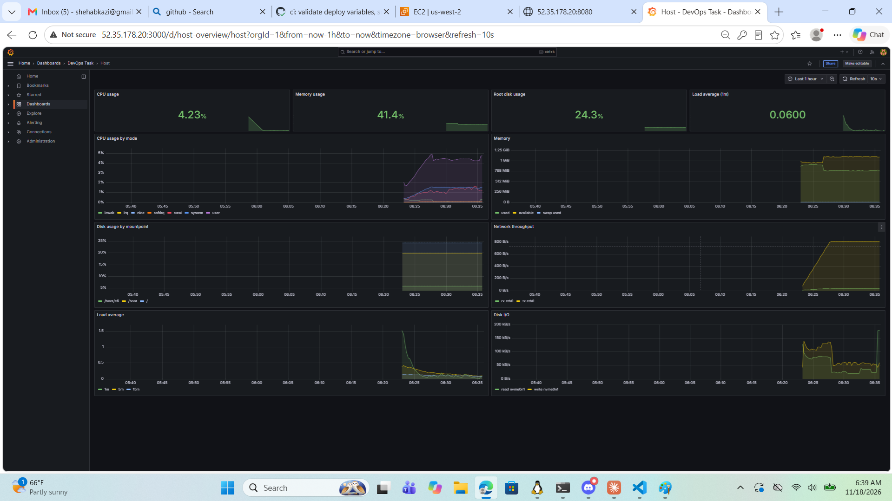
  
**Local Running Containers:**
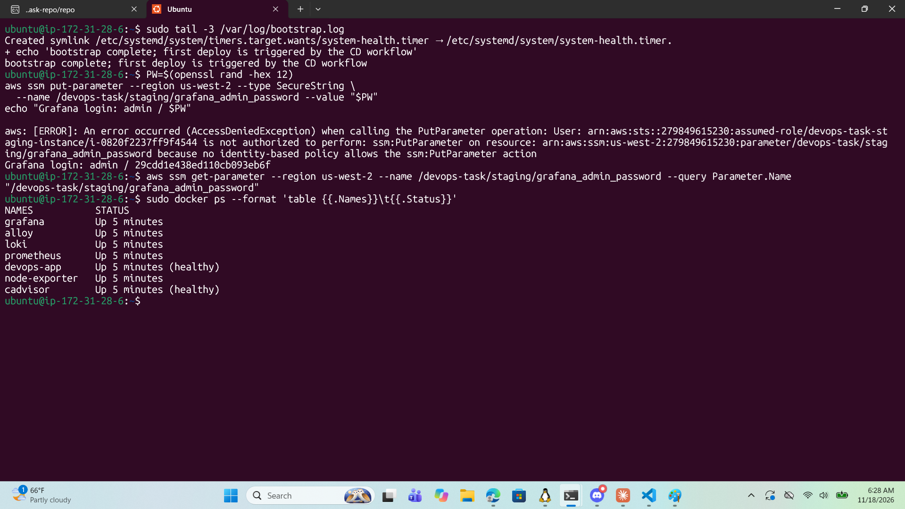

### Log labels (cardinality)

Indexed labels are only `container`, `service` and `level` (a handful of values each). `path`, `method` and `status` are
**structured metadata**: they can be filtered (`| path="/debug/error"`) without becoming index labels, because a label per
URL or status code would multiply the number of streams and bloat the index.

### Privileges granted and why

- **cAdvisor:** `privileged: true`, `/dev/kmsg`, and read-only mounts of `/`, `/var/run`, `/sys`, `/var/lib/docker` and
  `/dev/disk`. Required to read cgroup and container metadata, as documented upstream.
- **node-exporter:** read-only mounts of `/proc`, `/sys` and `/` (path flags point it at them) so CPU, memory and disk
  describe the **host**. It runs on the internal network with no published port. *Trade-off:* the network counters come from
  the container's own network namespace, so the "Network throughput" panel shows container traffic, not the whole server.
  Host-network mode would fix that, but it needs a route from Prometheus to the host, which is fragile across platforms.
- **Alloy:** runs as root with the Docker socket mounted read-only to discover containers and read their logs. The socket is
  effectively root on the host; a `docker-socket-proxy` would narrow it (listed under improvements).
- **Grafana credentials** come from `.env` or SSM; `GRAFANA_ADMIN_PASSWORD` is mandatory (Compose refuses to start without it).

### Alert rules

Defined in `observability/prometheus/rules/alerts.yml` and loaded through `rule_files` (visible read-only in Grafana,
Alerting, Alert rules).

| Alert | Condition | `for` | Why |
|---|---|---|---|
| AppDown | `up{job="app"} == 0` | 1m | 4 missed scrapes; tolerates a restart, still fast |
| HighErrorRate | 5xx ratio > 5% and > 0.1 req/s | 5m | sustained user impact; the traffic floor stops one failure on an idle service from paging |
| HighLatencyP95 | p95 > 500 ms | 10m | a trivial endpoint should be far faster; the long window avoids bursts |
| HostDiskUsageHigh | any real filesystem > 80% | 10m | disk fills slowly; leaves time to act; filters transient spikes such as image pulls |
| HostMemoryLow | memory used > 90% | 10m | based on MemAvailable, so page cache does not count |
| ContainerMemoryNearLimit | working set > 90% of limit | 5m | the working set is what the OOM killer uses; 5m ignores allocation bursts |

Prometheus evaluates the rules; without an Alertmanager they are not routed anywhere yet (see improvements).

### Walkthrough: "An error spike appears on the Application dashboard. How do you find the cause?"

1. **Scope it (metrics).** On *Application*, the error ratio stat and "Error rate by path" show *which endpoint* is failing and
   since when; "Requests by status code" shows whether it is 5xx only. Note the start time of the spike.
2. **Read the evidence (logs, same view).** The "App errors" Loki panel shares the time range and shows the `level=error`
   lines from the spike. Expand a line: `path`, `method`, `status`, `version` and, for exceptions, `exc` give the failing
   request and the stack trace.
3. **Correlate with change.** The `version` field tells you whether the errors began with a new release (compare with the CD
   run time). If yes, roll back (section 10).
4. **Rule out resources.** Open *Containers*: is the app near its memory limit or restarting (OOM)? Open *Host*: CPU, memory
   or disk saturation?
5. **Confirm the fix.** The error ratio returns to 0 and `AppDown` / `HighErrorRate` stay quiet. Use `docker logs` or
   CloudWatch only as a fallback if Loki is unavailable.

## 8. system_health.sh

```bash
./scripts/system_health.sh                       # text, appends to ./health_log.txt
./scripts/system_health.sh --json --disk 80 --cpu 90 --mem 85 --log-file /tmp/h.txt
./scripts/system_health.sh --help ; echo $?      # exit: 0 healthy, 1 warning, 2 critical, 64 usage error
shellcheck scripts/*.sh                          # clean
```

Collects CPU (1 s sample of `/proc/stat`), memory, every real mounted filesystem, load average and the top 5 processes by
memory. Warnings print as `[WARNING] ...`; critical thresholds (`--*-crit`, defaults 98/95/95) give exit code 2. Log rotation
happens at 1 MiB keeping 5 files; `flock` prevents overlapping runs. `HEALTH_WEBHOOK_URL` (environment variable)
optionally posts to Slack or Discord on warning or critical.

**Scheduling:** on EC2 the bootstrap installs the script and a **systemd timer that runs every 5 minutes**
(`scripts/systemd/`, log at `/var/log/system_health/health_log.txt`; exit code 2 marks the unit failed so it can be
alerted on). Cron alternative: `scripts/system-health.cron`.

## 9. Design decisions

- **Alpine vs distroless.** Distroless Python is tied to the distro's Python version and has no shell, which makes the
  HEALTHCHECK and debugging awkward. Alpine plus a venv copied from a build stage gives a small image, a non-root user and no
  pip or build tools in the final layer. Trade-off: musl instead of glibc (fine for pure-Python wheels) and a larger package
  set than distroless. The base image is pinned by tag; adding the `@sha256` digest is the next hardening step.
- **EC2 vs ECS vs EKS.** The brief asks for EC2, and one small host is the cheapest thing that runs both the app and a
  self-hosted monitoring stack. ECS/Fargate would remove host patching and the need for cAdvisor and node-exporter but costs
  more per vCPU and complicates the Compose-based observability; EKS adds about $73/month of control plane plus node cost,
  which is justified only with many services. Downside of one instance: no high availability.
- **SSM instead of SSH.** No inbound port 22, no key pairs; access is IAM-authenticated and logged, and CI deploys with
  `ssm:SendCommand` scoped to one instance.
- **Deploy by git checkout + Compose on the host.** The instance holds only configuration; images come from ECR. Simple and
  auditable, but the repo must be public (or the instance needs a deploy credential).
- **Tagging.** Immutable ECR tags: `0.1.<run>` (human-readable semver) and `sha-<commit>` (traceability). Deploys use the
  semver tag; the previous tag is recorded on the host for rollback.
- **Secrets.** No static AWS keys anywhere (OIDC plus instance profile). The runtime secret lives in SSM Parameter Store as a
  SecureString, fetched at deploy time into a `0600` `.env`; Terraform never sees its value.
- **Logs.** The app writes JSON to stdout; Docker's `awslogs` driver sends it to CloudWatch (retention set in Terraform)
  while Alloy ships it to Loki for Grafana (dual logging keeps `docker logs` working). Labels are low-cardinality.
- **Metric labels** use the route template, never the raw URL, so scanners cannot create unbounded series.
- **Terraform state** in S3 with versioning, encryption and the native lockfile (`use_lockfile`, Terraform >= 1.10),
  avoiding a DynamoDB table.
- **Ubuntu 24.04 LTS** (Canonical AMI found through a public SSM parameter, so nothing is hardcoded per region). The SSM
  agent ships preinstalled; the AWS CLI v2 and a pinned Compose plugin are installed by the bootstrap.
- **Instance size.** `t3.micro` (free tier, 1 GB) cannot hold the monitoring stack; `t3.small` is the floor for staging and
  `t3.medium` for production.

## 10. Deployment and rollback strategy

1. **Pull request:** all checks must pass (tests, lint, hadolint, shellcheck, Terraform validate, Trivy CRITICAL gate).
2. **Merge to `main`:** the image is built once (amd64 + arm64) and pushed with immutable tags.
3. **Staging** deploys automatically. **Production** is built from the same Terraform code but its job is switched off by
   default (`ENABLE_PRODUCTION`) and, when enabled, waits for a reviewer approval on the GitHub environment. It reuses the
   **same image** (build once, promote).
4. On the instance, `deploy.sh` records the current tag, pulls the new image, runs `docker compose up -d` and polls `/health`
   for up to 60 s.
5. **Automatic rollback:** if the pull, the start or the smoke test fails, it redeploys the previous tag, re-tests, and exits
   non-zero so the pipeline turns red.
6. **Manual rollback:** re-run CD for an earlier commit, or through SSM:
   `cd /opt/app && sudo ./scripts/deploy.sh <previous-tag>`. Kubernetes: `kubectl rollout undo deployment/devops-task`.
7. A concurrency group serialises deploys. Caveat: Compose recreates the single container, so there are a few seconds of
   downtime on EC2; zero downtime needs 2+ instances behind a load balancer (or the Kubernetes path).

## 11. Security considerations

- **Secrets:** none in git. OIDC for CI, the instance profile for the host, SSM SecureString for Grafana. `.env` is
  git-ignored and `0600` on the host. Kubernetes secrets are created out-of-band.
- **Image scanning:** Trivy in pull requests (fails on CRITICAL; HIGH is reported) plus ECR scan-on-push as a second check.
  `--ignore-unfixed` is on, so unpatchable CVEs do not block; review them periodically.
- **IAM least privilege:** the instance role can only pull from one ECR repo, write to one log group, read one SSM parameter,
  plus SSM core. The CI push role can only push to one repo and trusts only `main`. Deploy roles may `SendCommand` on one
  instance and one document and trust only the matching GitHub environment. GitHub issues the OIDC subject in the ID form
  (`owner@id/repo@id`) for this repository, so the trust policies pin that exact subject.
- **Network:** the security group opens 8080 (app) and 3000 (Grafana, admin IPs only; Terraform rejects `0.0.0.0/0`).
  **No SSH.** Prometheus, Loki, Alloy, node-exporter and cAdvisor have no published ports. IMDSv2 is required with hop limit 1,
  so containers cannot fetch instance credentials. EBS is encrypted.
- **Containers:** non-root UID 10001, read-only root filesystem, capabilities dropped, `no-new-privileges`, resource limits.
  Known exceptions: cAdvisor (privileged) and Alloy (root plus the Docker socket), documented above.
- **Gaps (honest):** HTTP only (no TLS) on 8080 and 3000; no WAF; Docker socket exposure; no image signing yet.

## 12. Monthly AWS cost estimate

Approximate, `us-west-2` (Oregon), on-demand, 24x7. Verify with the AWS Pricing Calculator.

| Item | Staging (t3.small) | Production (t3.medium) |
|---|---|---|
| EC2 | ~$15 | ~$30 |
| EBS gp3 30 GB | ~$2.4 | ~$2.4 |
| Public IPv4 (Elastic IP) | ~$3.7 | ~$3.7 |
| CloudWatch Logs (ingest + storage, low volume) | ~$1 | ~$2 |
| ECR + S3 state + SSM | <$1 | <$1 |
| Data transfer out | ~$1 | ~$2 to 5 |
| **Total** | **~$23** | **~$40** |

One `t3.medium` is the cheapest viable setup. An HA production variant (2 instances plus an ALB, about +$20 for the ALB and
double the compute) would be roughly $85 to 95. Destroying staging after testing reduces its cost to cents.

## 13. Problems I hit and what I learned

- **OIDC login failed** with "Not authorized to perform sts:AssumeRoleWithWebIdentity" although the trust policy looked right.
  Printing the token claims in a temporary step showed that GitHub sends the subject as
  `repo:owner@<id>/repo@<id>:...`, not `repo:owner/repo:...`. Fix: trust the exact subject GitHub sends.
- **Container names missing in cAdvisor.** cAdvisor v0.49.1 could not talk to a newer Docker Engine
  (`client version 1.41 is too old`), so metrics carried cgroup paths instead of container names. Fix: a newer cAdvisor image.
- **Trivy action not resolvable.** The pinned action tag no longer existed; I run Trivy from a pinned container image instead.
- **Alloy collected every container on my laptop,** including unrelated projects. Fix: a fixed Compose project name and a
  Docker discovery filter on that label.
- **Observability stack on a small host:** `t3.micro` cannot hold it; memory limits per container make the "memory near limit"
  alert meaningful.

## 14. What I would improve with more time

- Alertmanager routing to Slack or Discord; a runbook link on each alert.
- TLS (ALB + ACM) and a real domain; WAF; restrict app ingress.
- Two instances behind an ALB (or ECS/EKS) for zero-downtime deploys and HA; blue/green.
- Cosign image signing and an SBOM in CI; pin the base image and actions by digest/SHA; Dependabot or Renovate.
- Docker socket proxy for Alloy; CloudWatch agent for host metrics and alarms; backups for Grafana/Prometheus volumes.
- Host-network node-exporter (or the CloudWatch agent) for accurate host network metrics.
- Helm chart with staging/production values; kube-prometheus-stack on the cluster; OpenTelemetry tracing with Tempo.
- Integration/e2e test stage and a post-deploy synthetic check from outside the instance.
- Ansible hardening playbook (unattended upgrades, auditd).

## 15. AI usage note

I used AI assistants (Claude and Gemini) to scaffold and refine the application code, Dockerfile, Terraform, GitHub Actions
workflows, Kubernetes manifests, observability configuration and this documentation, and to help diagnose failures
(OIDC trust, cAdvisor and Docker API compatibility, the Trivy action, Terraform validation). I reviewed every file, ran the
tests, ShellCheck and hadolint, applied the Terraform to AWS myself, ran the pipeline, and verified the dashboards, so I can
explain and maintain each part of this submission.
